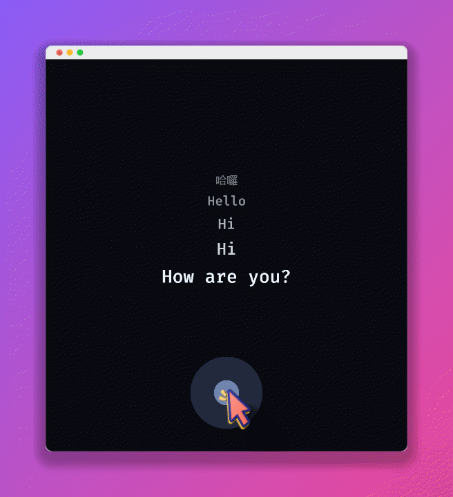
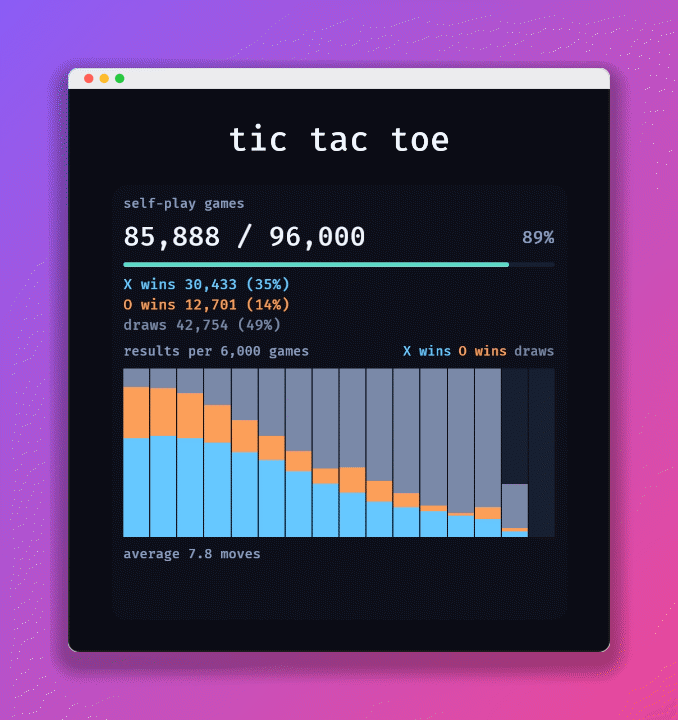

  

  <strong>Build AI-native games in Bevy</strong>

  
  
  
  
  
  

<table align="center">
  <tbody>
    <tr>
      <td align="center" valign="top">
         
        <a href="examples/mnist/README.md"><strong>mnist</strong></a> 
        Handwritten digit recognition
      </td>
      <td align="center" valign="top">
         
        <a href="examples/speech/README.md"><strong>speech</strong></a> 
        Live speech transcription
      </td>
    </tr>
  </tbody>
  <tbody>
    <tr>
      <td align="center" valign="top">
         
        <a href="examples/tictactoe/README.md"><strong>tictactoe</strong></a> 
        Play against the trained AI
      </td>
    </tr>
  </tbody>
</table>

## What is bevy-neura?

**bevy-neura** is built on **[Neura](https://github.com/formetaohy/Neura)**, using **DX12, Metal, and Vulkan** for neural network training and inference, enabling you to build **AI-native games** in **[Bevy](https://bevy.org)**.

## Features

- **Game-loop Integration**: Run training and inference directly from your frame loop, without async/await.
- **Cross-platform Deployment**: Use your game's native graphics API directly — Neura runs right alongside your game.
- **Kernel Compiler**: Write custom kernels in Rust; Neura generates SPIR-V, HLSL, and MSL, so you do not maintain separate shader implementations.
- **High Performance**: End-to-end optimization for fast training and inference with a small memory footprint.

## Documents

- **[Examples](examples)**: See how to integrate AI into your game.

## Contact

Email: formetaohy@gmail.com

## License

[MIT](LICENSE)
